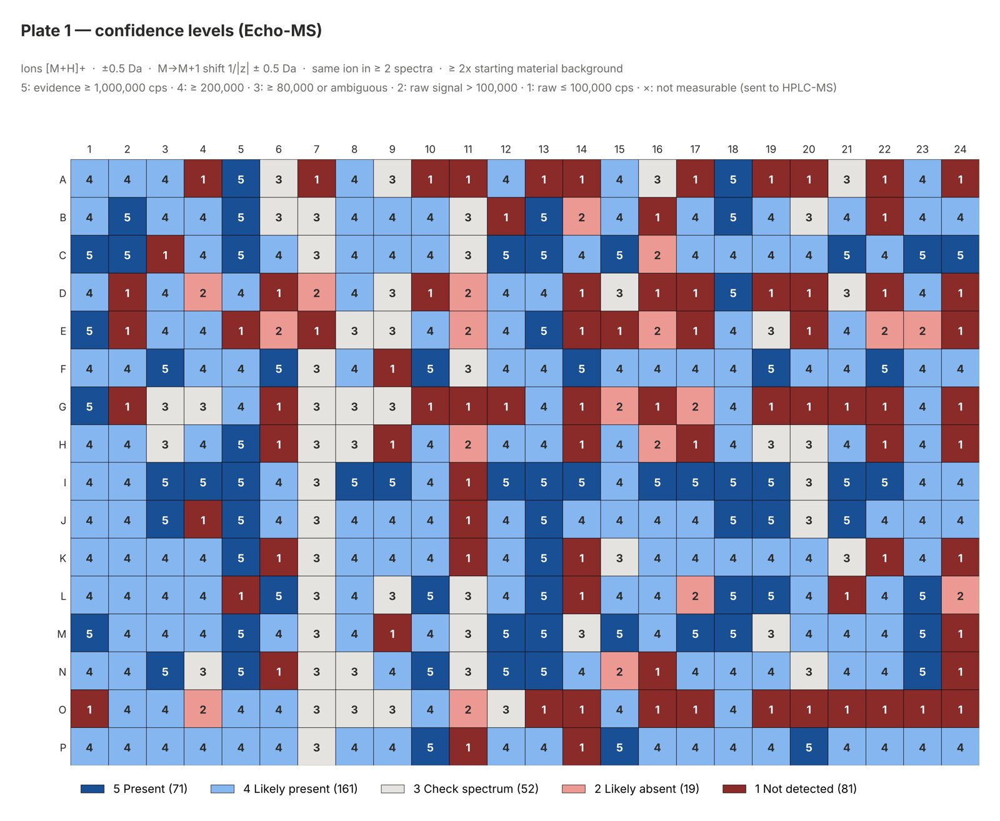
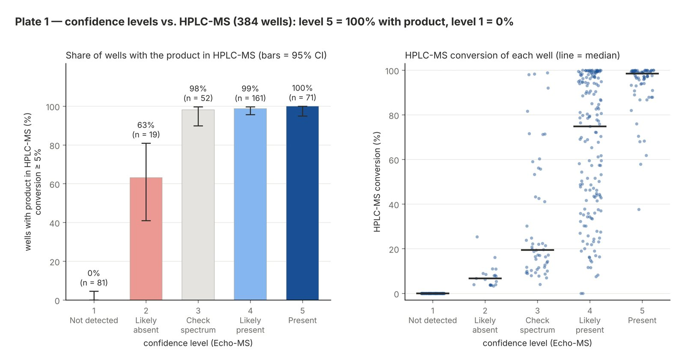
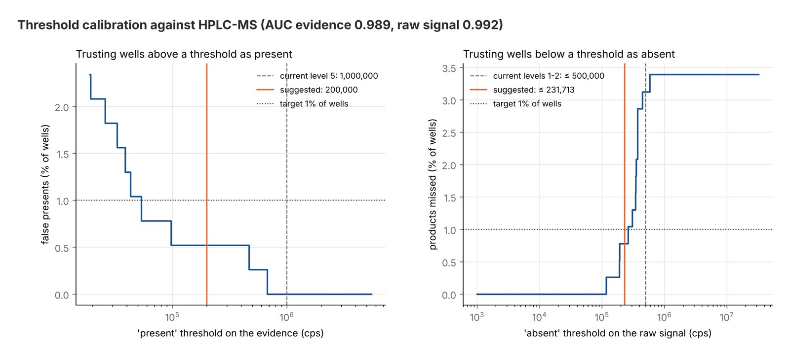
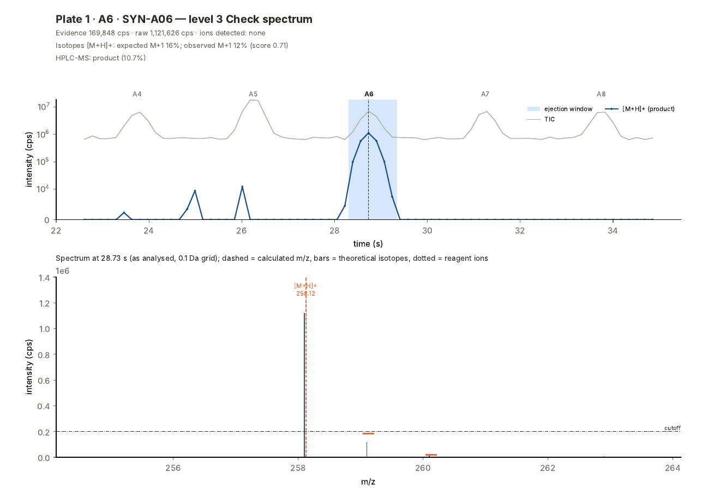
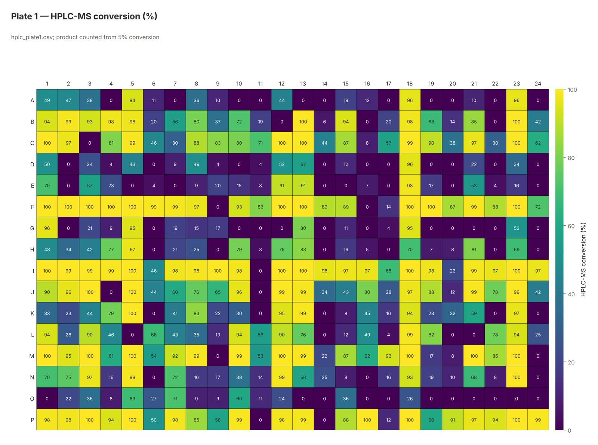
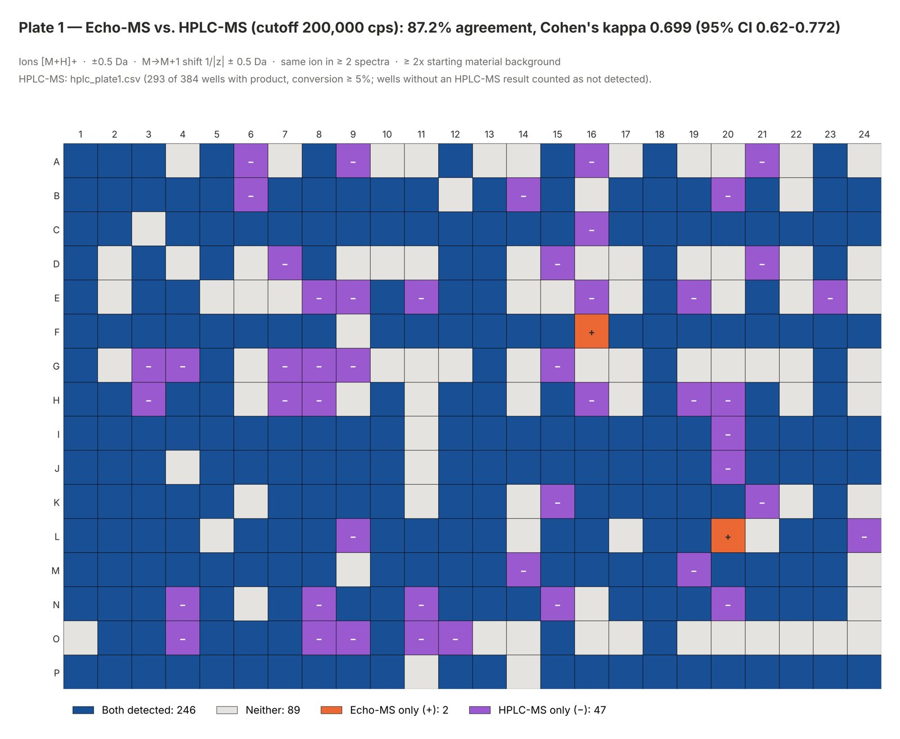

# TriADE

**TriADE** (*triage for acoustic droplet ejection mass spectrometry*) detects reaction products in
**acoustic-ejection mass spectrometry (Echo-MS / ADE-OPI-MS)** plate runs, with
**five confidence levels** per well and an **HPLC-MS triage**: which wells can skip HPLC-MS, and how much
instrument time and mobile phase that saves.

* Input: the mzML file of each plate run, a sample table (wells, sample codes, product and
  starting-material SMILES, optional injection order) and, optionally, HPLC-MS results.
* Output: plate maps, per-well tables, the triage table with an HPLC-MS worklist, QC charts and one Excel
  workbook — all in a folder and a zip file.
* 96-, 384- and 1536-well plates; positive, negative or polarity-switching runs; a catalogue of adducts and
  clusters to choose from; triple/single-quadrupole data and, experimentally, high-resolution (QTOF/Orbitrap) data.
* An Excel input template with a reagent library, a preview of what the program understood, a spectrum viewer
  for every well, statistics (confidence intervals, threshold calibration, probability of product per well,
  run QC) and figures in six palettes and five file formats.
* A browser interface (runs on your own computer), a command line and a Python API.



*All figures in this README come from a synthetic plate made by the program itself (`triade-synthetic`);
no real data are included in the repository.*

---

## Contents
1. [Installation](#1-installation)
2. [Quick start](#2-quick-start)
3. [Input files](#3-input-files)
4. [How a well is graded](#4-how-a-well-is-graded)
5. [Choosing ions: read this before adding adducts](#5-choosing-ions-read-this-before-adding-adducts)
6. [HPLC-MS comparison and triage](#6-hplc-ms-comparison-and-triage)
7. [Statistics](#7-statistics)
8. [Spectrum viewer and figures](#8-spectrum-viewer-and-figures)
9. [Outputs](#9-outputs)
10. [Settings](#10-settings)
11. [Testing and validation](#11-testing-and-validation)
12. [Limitations](#12-limitations)
13. [License and citation](#13-license-and-citation)

---

## 1. Installation

No Python experience is needed: follow the steps in order. Each grey box holds **one command**: type it (or
copy and paste it) and press **Enter**, then wait until it finishes before typing the next one.

### Step 1 — Install Python (once)

1. Go to <https://www.python.org/downloads/> and download **Python 3.12** (any version from 3.10 to 3.13 works).
2. Run the installer. **On Windows, tick "Add python.exe to PATH"** at the bottom of the first window, then click
   *Install Now*.

### Step 2 — Download the program (once)

1. On the GitHub page of the program, click the green **Code** button → **Download ZIP**.
2. Unzip it, for example in *Documents*. You get a folder called `triade`; inside it you see
   `pyproject.toml`, `README.md` and the folders `src` and `tests`.

### Easiest way: double-click

Inside the `triade` folder, double-click:

| System | File |
|---|---|
| Windows | `start_windows.bat` |
| macOS / Linux | `start_mac_linux.command` (on macOS the first time: right-click → *Open*) |

The first time it installs everything (internet needed, a few minutes); after that it opens the interface in
your browser within seconds. If this works, you can skip the rest of this section.

### Step-by-step way (also used to run the tests)

#### Step 3 — Open a terminal inside the program folder

**Windows**
1. Open the `triade` folder in File Explorer (the one with `pyproject.toml`).
2. Click once on the **address bar** at the top of the window (where the folder path is shown).
3. Delete what is written there, type `cmd` and press **Enter**.

A black window (Command Prompt) opens, already inside the folder. Use this window, not PowerShell.

**macOS**
1. Open the **Terminal** app (Cmd + Space, type *Terminal*, Enter).
2. Type `cd` followed by a space (do not press Enter yet).
3. Drag the `triade` folder from Finder into the Terminal window, then press **Enter**.

To check that you are in the right place, type the command below and press Enter: the list must show
`pyproject.toml`.

Windows:
```
dir
```
macOS:
```
ls
```

#### Step 4 — Create the program's own Python environment (once)

Windows:
```
py -3.12 -m venv .venv
```
macOS:
```
python3 -m venv .venv
```

This creates a `.venv` folder with a private copy of Python for the program. (Windows: if `py` is not
recognised, use `python -m venv .venv`; with Python 3.10, write `py -3.10 -m venv .venv`.)

#### Step 5 — Activate the environment (every time you open a new terminal)

Windows:
```
.venv\Scripts\activate
```
macOS:
```
source .venv/bin/activate
```

The line in the terminal now starts with `(.venv)`.

#### Step 6 — Install the program (once; needs internet, a few minutes)

```
pip install -e ".[app,dev]"
```

#### Step 7 — Check that everything works (optional)

```
pytest
```

After 2–3 minutes it must end with something like `82 passed` and no `failed`.

#### Step 8 — Open the interface

```
triade-app
```

Your browser opens the interface (if it does not, type `http://localhost:8501` in the browser's address bar).
Keep the terminal window open while you use the program; to stop it, go back to the terminal and press
**Ctrl + C** (or close the window).

### Next times

Either double-click `start_windows.bat` / `start_mac_linux.command`, or open a terminal in the folder (step 3)
and type, one at a time:

Windows:
```
.venv\Scripts\activate
```
```
triade-app
```
macOS:
```
source .venv/bin/activate
```
```
triade-app
```

### Updating to a new version

1. Download the new ZIP and copy its contents over the old `triade` folder (replace the files; keep
   the `.venv` folder).

   *Coming from version 1.3 or earlier (then called echo-ms-screening)?* Unzip TriADE into a **new** folder
   instead and start it with `start_windows.bat` / `start_mac_linux.command`, or do steps 3–6 again: the
   program and its commands were renamed (`triade-app` instead of `echo-ms-app`), so it needs a new
   environment. The old folder can then be deleted.
2. Open a terminal in the folder (step 3), activate the environment (step 5) and type:

```
pip install -e ".[app,dev]"
```

### If something goes wrong

| Message | What to do |
|---|---|
| `'python' / 'py' is not recognized` | Python is not installed or "Add python.exe to PATH" was not ticked: run the Python installer again (Modify → tick *Add Python to environment variables*). |
| `running scripts is disabled on this system` | You are in PowerShell: open the Command Prompt instead (step 3, typing `cmd`). |
| `'triade-app' is not recognized` | The environment is not active: do step 5 (the line must start with `(.venv)`). |
| `No module named …` | Do step 6 again (with the environment active). |
| The browser does not open | Type `http://localhost:8501` in the browser. |

**Optional extras.** Without RDKit the program uses its own SMILES reader (common organic SMILES); RDKit is
installed by the command of step 6. mzML files are read by the program's own reader (uncompressed or zlib);
for files with MS-Numpress compression type `pip install -e ".[numpress]"` or convert them again without
Numpress.

## 2. Quick start

**Browser interface** — start it as in step 8 (or with the double-click file). The sidebar has the
**essentials** (instrument, plate format, ionisation mode, ions) and, folded below, the
**advanced** settings; settings can be saved as named **method profiles**. Choose the essentials, upload the
files in *Inputs*, check them in *Preview*, press **Run the analysis** and open *Results*, *Spectrum viewer*
and *Statistics*. *Load a synthetic example* lets you try everything without your own files. The analysis runs
on your computer; the files are not sent anywhere.

**Command line**

```bash
triade --mzml "Plate 1 delay 2500.mzML" "Plate 2 delay 2500.mzML" \
        --samples samples.xlsx --hplc hplc_plate1.csv hplc_plate2.csv \
        --plate-format 384 --polarity positive --ions "[M+H]+" --out results
triade --help          # every option
triade --list-ions     # the ion catalogue
triade --template input_template.xlsx --plate-format 384   # the Excel input template
triade-synthetic --plate 384 --out example_data   # a synthetic plate to try
```

**Python**

```python
from triade import Inputs, Settings, run_analysis

res = run_analysis(
    Inputs(mzml=["Plate 1 delay 2500.mzML"], samples="samples.csv", hplc=["hplc_plate1.csv"]),
    Settings(plate_format="384", polarity="positive", ions=["[M+H]+"], cutoff_cps=200_000),
    out_dir="results")
res.summary            # one row per plate
res.results["1"]       # one row per well
res.triage             # HPLC-MS savings per scenario
res.worklist           # wells that still need HPLC-MS
```

## 3. Input files

The easiest way to prepare the inputs is the **Excel template**: *Download the input template* in the interface,
`triade --template input_template.xlsx --plate-format 384`, or [`examples/input_template.xlsx`](examples/).
*Prepare a complete synthetic example* in the interface gives a full set of files (mzML, tables) to look at.
The **Preview** tab shows what the program understood — formulas, m/z of each ion, reagents on a plate grid and
any problem — before you run.

### mzML (required, one per plate)
Convert the instrument files (e.g. SCIEX `.wiff`/`.wiff2`) with ProteoWizard **msConvert**, MS1 spectra,
**without MS-Numpress** compression (zlib is fine). The program reads the scan time and polarity of every
spectrum. A file name containing `Plate 2` sets the plate ID and `delay 2500` sets the time between
ejections (2.5 s); both can also be given in the interface or on the command line. High-resolution data must be
**centroided** (msConvert filter `peakPicking`).

### Sample table (required): the template, or a CSV/TSV/Excel list

| Sheet / column | Required | Meaning |
|---|---|---|
| **Reagents** sheet: `Code`, `SMILES`, `Name`, `Role` | recommended | a library: each reagent written once, used by its code elsewhere |
| **Samples** sheet (or a CSV/Excel list): | | one row per well |
| &nbsp;&nbsp;`Plate` | if more than one plate | plate ID matching the mzML file |
| &nbsp;&nbsp;`Well` | yes | `A1`, `a01`, `AF48`… (validated for the plate format) |
| &nbsp;&nbsp;`Sample_Code` | no | your sample identifier |
| &nbsp;&nbsp;`Product_SMILES` | yes | expected product (SMILES or a library code) |
| &nbsp;&nbsp;`Reagent_1`, `Reagent_2`, … | recommended | the reagents of the well (library code or SMILES), one per column |
| &nbsp;&nbsp;`Injection_Order` | no | ejection order (1, 2, 3…); needed for cherry-picked or custom orders and replicates |
| &nbsp;&nbsp;`Control` | no | `positive`, `negative` or `blank` for control wells (plate acceptance) |
| &nbsp;&nbsp;`Replicate` | no | 1, 2, 3… for repeated ejections of the same well (with `Injection_Order` of every ejection) |
| **Map** *field* **P***plate* sheets | no | plate-shaped grids (e.g. `Map Reagent_1 P1`) instead of, or in addition to, the list |
| **HPLC-MS** sheet: `Plate`, `Well`, `Conversion_%` | no | HPLC-MS results (an empty conversion = no result) |

`Reagent_1` should be the reagent **shared by a series of wells** (e.g. the starting material of a plate row):
the background control compares each well with the wells that share it. Every reagent is checked as a possible
interference (its Na⁺, K⁺, NH₄⁺, DMSO or MeOH adduct, or its ³⁷Cl isotope, falling on the product m/z).
Common alternative column names are recognised (`Position`, `SMILES`, `Code`, `Injection order`…), the older
`SM_SMILES` column (several SMILES separated by `;`) still works, and an Excel file may also have one sheet per
plate named `Plate 1`, `Plate 2`…. If each plate row shares one starting material, a separate table
`Row, SMILES[, Plate]` can be given instead.

### HPLC-MS results (optional)
In the template's HPLC-MS sheet, or one file per plate (or one file with a `Plate` column) with `Well` and
either `Conversion_%`, or `Product` (yes/no), or the instrument export with `Ratio` and `Area` columns (the
largest ratio is used; a well with every area at zero had no signal). Wells without a result, without signal or
marked as indeterminate (option *HPLC-MS results to treat as indeterminate*, e.g. `2:9` for column 9 of plate 2)
**count as not detected** in every comparison.

### m/z range
Any scanned range works: the program reads it from each mzML. A product whose ion falls **outside the range**
cannot be measured: the well is marked **× Not measurable** and is **always sent to HPLC-MS** (never trusted as
absent). Below about 200 Da solvent and matrix ions are dense (more false positives); small molecules have a weak
M+1 peak (≈ 1.1 % per carbon), so with the standard M+1 rule they need a stronger M peak (the *relative* M+1 rule,
a non-standard option, avoids this); doubly charged ions are handled (isotope spacing 0.5).

## 4. How a well is graded

1. **Ejection grid.** The total ion current pulses at every ejection. A periodic comb fitted to the
   normalised TIC gives the period and the time of each pulse.
2. **Which pulse is which well.** If the sample table has `Injection_Order`, that order is used; otherwise
   the program tests the usual Echo patterns (row/column, serpentine or not) and every start position, and
   keeps the one in which most wells show their own product ion. The choice and its margin over the
   second-best hypothesis are in the log and in `5_QC/`.
3. **Ion search.** In each spectrum of the ejection window (by default 0.45 s before to 0.60 s after the
   apex), for each selected ion, the program looks for the **M peak** within ±0.5 Da of the theoretical m/z
   (≥ cutoff) and a separate **M+1 peak** 1.003/|z| Da above it. The ion is *validated* when this holds in
   **≥ 2 spectra**. Two M+1 rules are available:
   * *absolute* (default, as in the program's development): M+1 ≥ 50 % of the cutoff;
   * *relative* (non-standard option): M+1 ≥ 0.7 × the M+1 expected from the formula × M, and
     ≥ 20,000 cps. It helps small molecules; on the development plates it found more products but also a few
     more false positives.
4. **Background control.** The ejection signal must be at least 2× the median signal at the same m/z in
   the wells that share `Reagent_1` (wells whose own product ions are within 1.5 Da are left out). This removes
   signals that belong to the starting material or the well series, not to the product.
5. **Confidence level.**

| Level | Label | Rule (defaults) |
|---|---|---|
| 5 | Present | validated evidence ≥ 1,000,000 cps |
| 4 | Likely present | validated evidence ≥ cutoff (200,000 cps) |
| 3 | Check spectrum | evidence ≥ 80,000 cps, or raw [M+H]+/[M-H]- > 500,000 cps without validation, **or** a level 4–5 well with a problem: a reagent ion within 1 Da of the protonated/deprotonated product, a previous ejection ≥ 5× stronger at the product m/z (carryover), or only a secondary adduct validated |
| 2 | Likely absent | no validated ion; raw signal > 100,000 cps |
| 1 | Not detected | raw signal ≤ 100,000 cps |
| × | Not measurable | no structure, m/z outside the scanned range, polarity not acquired or no ejection: **always sent to HPLC-MS** |

The binary *Detected* call (any validated ion) and the three-way call (*Detected* = 4–5, *Check spectrum*
= 3, *Not detected* = 1–2) are also reported.

**Standard method.** All the detection and grading criteria above (tolerances, cutoff, M+1 rule, number of
spectra, background control, level thresholds, carryover, ejection window, the HPLC-MS product threshold, the
replicate rule and the plate-acceptance limits) are **fixed**: the user chooses only the ions. Analyses made by
different people, on different days, are therefore comparable. The intensity thresholds were set on a SCIEX
Triple Quad 6500 and depend on the instrument's intensity scale; to adapt them to another instrument, the
interface has an explicit option *Use non-standard criteria (requires validation)* (on the command line and in
`settings.json` any change is accepted the same way). Every output of such an analysis — `Summary.csv` (column
`Method`), the warnings, the figure subtitles, the report and `settings.json` — is then marked
**NON-STANDARD PARAMETERS** with the values that differ. Validate non-standard criteria against HPLC-MS before
using them for triage.

**Isotope pattern (information).** For every well the program computes the theoretical isotope pattern of the
main ion from the formula (M+1 from ¹³C/¹⁵N, M+2 from Cl, Br, S…), names the **confirmation peak** (the most
intense isotope peak after M: M+2 for chlorinated or brominated products) and compares the pattern with the
spectra of the ejection (*Isotope_Theoretical*, *Isotope_Observed*, *Isotope_Pattern_Score* from 0 to 1). This is
reported and drawn in the spectrum viewer but **does not change the level**: on the plates used to develop the
program the pattern did not separate false from true detections better than the intensity.

**Instrument.** *Unit resolution* (triple or single quadrupole) analyses the spectra on a 0.1 Da grid with
tolerances in Da. *High resolution* (QTOF/Orbitrap, **experimental**: tested on synthetic data only) keeps the
centroid peaks as they are (no grid, so memory stays low), uses tolerances in ppm (default ±10 ppm) and places
the M+1 peak at +1.00335/|z| Da. The program reads the instrument model, the centroid/profile flag and the m/z
spacing of each file and warns when they do not match the chosen setting.

## 5. Choosing ions: read this before adding adducts

The default is the protonated molecule `[M+H]+` in positive mode and the deprotonated molecule `[M-H]-`
in negative mode. Other ions are available: `[M+Na]+`, `[M+K]+`, `[M+NH4]+`, `[M+H-H2O]+`,
`[M+MeOH+H]+`, `[M+ACN+H]+`, `[M+DMSO+H]+`, `[2M+H]+`, `[2M+Na]+`, `[M+2H]2+`, `[M+Cl]-`, `[M+HCOO]-`,
`[M+CH3COO]-`, `[M-H-H2O]-`, `[2M-H]-`.

> **Every extra ion is another m/z per well where something else can pass the criteria.** In acoustic
> ejection there is no chromatography: salts, DMSO and solvent reach the source with the analyte, so metal
> adducts and solvent clusters of the *starting materials, reagents and by-products* are abundant, and in a
> combinatorial plate one of them often lands on a product's adduct m/z. Each such coincidence is a
> **false positive**, and in a triage a false positive is the costly error: the well is declared present
> and never sent to HPLC-MS.

On the synthetic 384-well example (`triade-synthetic --plate 384 --seed 11`), adding `[M+Na]+` to `[M+H]+` raised the wells detected only by Echo-MS
(no product by HPLC-MS) from 2 to 9 and lowered Cohen's kappa from 0.70 to 0.65, without finding a single
extra real product. The same pattern — more false than true extra detections — was seen on the real plates
used to develop the program.

Recommendations:
* start with the protonated/deprotonated molecule only;
* add an adduct only when you expect it for your chemistry, sample solvent and carrier solvent (e.g.
  formate in negative mode with formic acid in the carrier);
* compare the two choices against HPLC-MS on one plate before adopting an adduct;
* a well found only through a secondary adduct is graded 3 (*Check spectrum*), never 4–5, as long as the
  protonated/deprotonated molecule is also selected.

## 6. HPLC-MS comparison and triage

With HPLC-MS results the program adds, per plate: agreement and Cohen's kappa of the binary call, the share
of wells with product at each confidence level, and Spearman correlations with the HPLC-MS conversion.



The triage table compares six scenarios — which levels are trusted without HPLC-MS:

| Scenario | Trusted as present | Trusted as absent | Sent to HPLC-MS |
|---|---|---|---|
| 0 | – | – | everything |
| 1 | – | 1 | 2–5 |
| 2 | – | 1–2 | 3–5 |
| 3 | 5 | 1 | 2–4 |
| 4 | 5 | 1–2 | 3–4 |
| 5 | 4–5 | 1–2 | 3 |

For each scenario: injections, HPLC-MS time and mobile phase used and saved (run time and flow rate are
settings), the net saving after the Echo-MS run time and — with HPLC-MS results — the false presents and
missed products. The worklist of the chosen scenario (default 4) is written as a ready-to-use CSV.
**Validate the scenario against HPLC-MS on at least one plate of the same chemistry before relying on
it.**

## 7. Statistics

With HPLC-MS results for at least one plate (`6_statistics/` and the *Statistics* tab):

* **95 % confidence intervals** (Wilson) for the share of wells with product at each level and for the
  triage error rates; a bootstrap interval for Cohen's kappa. "Level 5 = 97 %" from 37 wells really means
  "between ~86 % and ~99.5 %".
* **Threshold calibration.** For an acceptable error rate (default 1 % of the wells) the program finds the lowest
  evidence above which wells can be trusted as present and the highest raw signal below which they can be
  trusted as absent. With several plates, the thresholds fitted on the other plates are tested on each plate:
  this shows how well thresholds carry over to a new plate.

  
* **Probability of product per well** (`P_Product`): a logistic regression on the Echo-MS measurements
  (evidence, raw signal, product/reagent ratio, carryover, interference, isotope score, valid spectra). Each
  plate is also predicted by a model that never saw it (AUC and Brier score). The model is saved as
  `probability_model.json` and can be applied to new plates without HPLC-MS.
* **Run QC.** The height of each ejection pulse over the run (drift, weak or failed ejections, flagged in
  `Run_QC_Flag`) and, optionally, an **internal standard** m/z present in every well.
* **Comparing two analyses** (interface, *Results*): keep one analysis, change a setting, run again — changed
  calls and **McNemar's test** tell whether the difference (e.g. adding an adduct) is larger than chance.

## 8. Spectrum viewer and figures

The *Spectrum viewer* tab shows **any well**: click it on the plate map, see its ejection trace (TIC and the
product-ion signals, with the analysed window and the neighbouring wells), click any point to see that spectrum
(as analysed, raw from the mzML, or the maximum/mean of the window) with dashed lines at the **calculated m/z of
every ion analysed**, the theoretical isotope peaks, the reagent ions and the cutoff. Each view can be downloaded
as PNG, SVG or CSV. The same page, for the wells you choose (level 3 by default, chosen levels, or all), is
written to `7_spectra/Spectra_by_well.pdf`.



Plate maps can show the **reagent codes along the axes** (row: `A · SM-3`, column: the code of `Reagent_2`),
**round wells**, and **outlines** for wells that differ from HPLC-MS, wells reviewed by hand, controls (P/N/B) and
run-QC flags. A **composite figure** puts the Echo-MS levels and the HPLC-MS conversion side by side (panels a/b).
**Publication mode** draws every figure at a journal width (85, 120 or 180 mm) with the text scaled to it, without
titles (they go to `Figure_captions.txt`), in the chosen font (Arial, Helvetica, Times New Roman…).

Every figure follows the chosen **palette** — Default, Viridis, Cividis, Okabe-Ito (colour-blind safe),
Grayscale (print) or Custom (a colour for each category) — and is saved as **JPEG, PNG, TIFF, SVG or PDF** at the
chosen resolution and **font size** (0.8× to 2×). Intensity and conversion maps can show the value in each cell.



## 8b. Review, export, controls, replicates, side products and report

* **Manual review.** In the spectrum viewer every well can get a decision — *confirmed present*, *confirmed absent*
  or *send to HPLC-MS* — with a comment. The worklist follows the decisions at once; they are saved as `review.csv`
  (load it again with the next analysis) and drawn on the maps (dashed outline).
* **Export for the instruments.** `3_triage/HPLC-MS_transfer_and_sequence_scenario_N.xlsx`: a **transfer list**
  (source plate/well → destination plate/well, optional volume) and an **injection sequence** (optional blank every N
  samples). The columns are generic, so they can be mapped to any liquid handler or HPLC-MS software.
* **Controls.** Wells marked `positive`, `negative` or `blank` are left out of the triage and the statistics; the plate
  is **accepted** when ≥ 100 % of the positive controls and ≤ 0 % of the negatives/blanks are detected (both limits are
  settings). The result is in `Summary.csv`, the warnings and the report.
* **Replicate ejections.** Repeated ejections of a well (column `Replicate`) are analysed one by one and combined:
  the well is detected when *any*, the *majority* or *all* replicates detect it; its level is the median of the
  replicate levels (level 3 when the two disagree). Fleiss' κ, the agreement of the calls and the CV of the evidence
  between replicates are reported; the spectrum viewer shows each replicate.
* **Side products.** Rules such as `hydrolysis: Reagent_1: -Cl +OH` or `oxidation: Product: +O` (one per line) are
  searched in every well with the product criteria; each gets columns in the results and a plate map
  (`8_side_products/`).
* **Report.** `Report.html` (self-contained) and `Report.pdf`: a methods paragraph written from the settings, the
  plates, controls, triage, warnings and the main figures.
* **Control charts across plates.** With a *project history* file (a CSV on your computer), every analysis adds one
  row per plate (pulse height, drift, internal-standard CV, % detected, % level 5, controls, agreement with
  HPLC-MS, replicate κ). From the 6th run on, Shewhart limits (± 3 SD of the earlier runs) and a CUSUM flag runs that
  drift away from the usual behaviour (`5_QC/Control_charts`).

## 9. Outputs

```
results/
├── Summary.csv                    one row per plate (counts per level, agreement, kappa and its CI, run QC…)
├── All_results.xlsx               every table in one workbook, with the settings
├── settings.json                  the settings used (load it again to repeat the analysis)
├── log.txt, warnings.txt
├── 1_detection/                   per-well table; maps: log10 intensity, binary, 3 categories, vs HPLC-MS
├── 2_confidence_levels/           levels table and map; HPLC-MS conversion map; levels vs HPLC-MS chart
├── 3_triage/                      savings per scenario (with CIs), worklist (CSV and Excel transfer list +
│                                  injection sequence), review decisions, discrepancies
├── 4_time_charts/                 TIC over the run with the time span of each plate row
├── 5_QC/                          ejections on the TIC, mean ejection profile, run QC, order hypotheses,
│                                  project history and control charts
├── 6_statistics/                  levels with CIs, threshold calibration, probability model and its validation
├── 7_spectra/                     Spectra_by_well.pdf
├── 8_side_products/               one map per side-product rule
├── Report.html, Report.pdf        the analysis report
└── Figure_captions.txt            (publication mode) titles and legends of the figures
```



## 10. Settings

All settings are in [`src/triade/settings.py`](src/triade/settings.py) with comments (the fixed criteria of the
standard method are listed there in `STANDARD_CRITERIA`), are available in
the interface sidebar and on the command line (`triade --help`), and are saved in `settings.json` with every run.
The main ones:

| Setting | Default | |
|---|---|---|
| `instrument` | unit | unit (quadrupole), high (QTOF/Orbitrap, experimental) |
| `plate_format` | 384 | 96, 384, 1536 |
| `polarity` | positive | positive, negative, both |
| `ions` | `[M+H]+` | see section 5 |
| `cutoff_cps` | 200,000 | M-peak intensity; level 4 threshold |
| `level5_cps` / `level3_cps` | 1,000,000 / 80,000 | |
| `level1_raw_max_cps` / `level2_raw_max_cps` | 100,000 / 500,000 | |
| `m1_rule` | absolute | absolute (M+1 ≥ 50 % of the cutoff) or relative (vs. the formula) |
| `mass_tolerance_da` / `mass_tolerance_ppm` | 0.5 / 10 | unit / high resolution |
| `min_spectra` | 2 | same validated ion in ≥ N spectra |
| `background_group` / `background_ratio` | starting_material (Reagent_1) / 2 | background control |
| `ejection_period_s` | from the file name or the data | |
| `ejection_order` | auto | auto, table, row-serpentine, row-major, column-serpentine, column-major |
| `hplc_run_min` / `hplc_flow_ml_min` | 5 / 0.6 | triage time and solvent |
| `hplc_product_min_pct` | 5 | HPLC-MS conversion counted as product |
| `target_false_present_pct` | 1 | threshold calibration target (% of wells) |
| `internal_standard_mz` | none | run QC |
| `palette` / `figure_format` / `figure_dpi` | default / jpg / 300 | figures |
| `font_scale` | 1 | text size of the figures and interactive charts (0.5–2) |
| `spectra_pdf` | check | none, check (level 3), levels, all |
| `replicate_rule` | majority | any, majority, all |
| `control_min_positive_pct` / `control_max_negative_pct` | 100 / 0 | plate acceptance |
| `side_products` | none | rules `name: Product|Reagent_k: change` |
| `transfer_plate_format` / `transfer_volume_nl` / `blank_every` | 96 / – / 0 | Excel export |
| `figure_width_mm` / `show_titles` / `font_family` | – / true / default | publication mode |
| `well_shape` / `axis_reagent_labels` / `highlight_wells` | square / true / true | plate maps |
| `report` | true | Report.html and Report.pdf |

## 11. Testing and validation

```bash
pip install -e ".[dev]"      # or ".[app,dev]"
pytest
```

The tests generate synthetic plates (96, 384 and a partial 1536-well plate including rows AE–AF; positive
and negative mode; serpentine and shuffled ejection orders; unit and high resolution) and check the ejection
grid and order, the grading, the not-measurable category, the isotope patterns, the HPLC-MS comparison, the
triage, the statistics, every input format (template, reagent library, plate maps), every palette and file
format, the command line and the browser interface. See [`docs/TESTING.md`](docs/TESTING.md) for details and
for how to validate the program on your own plates.

## 12. Limitations

* Developed and validated on unit-resolution triple-quadrupole data. The high-resolution mode, polarity
  switching and 1536-well plates have been tested on synthetic data only.
* Products of the same nominal mass in neighbouring wells, or isobaric with a reagent ion, cannot be told apart
  at unit resolution; the second case is flagged (level 3).
* The ejection order must either follow a standard pattern or be given in the sample table.
* Echo-MS ion intensity depends strongly on ionisation efficiency; the levels say how sure the detection
  is, not how much product there is.
* Thresholds, the probability model and the triage scenario are specific to a chemistry and a method: check
  them against HPLC-MS on at least one plate (the *Statistics* tab shows how well they carry over between
  plates).

## 13. License and citation

MIT — see [LICENSE](LICENSE). If you use the program in published work, please cite the article:

> Barbosa-Reis, G.; La Scola, E.; Pereira, T. M.; Kintlova, M.; Mori, M.; Meneghetti, F.; Džubák, P.;
> Oliveira-Silva, D.; Dömling, A. *Triple-ADE Workflow Integrating Nanoscale Chemistry, ECHO-MS Reaction Analysis,
> and Direct-to-Biology Kinase Screening.* (journal and DOI to be added on publication)

The same reference is in [CITATION.cff](CITATION.cff) (GitHub shows it under *Cite this repository*).
